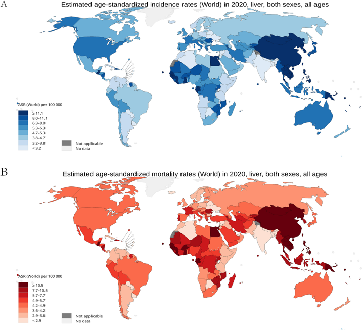
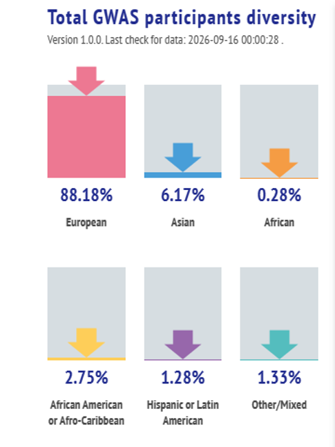
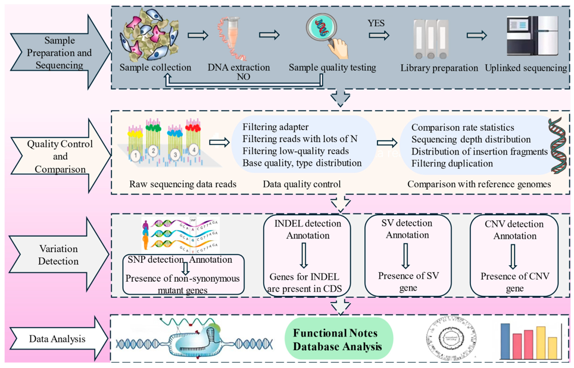
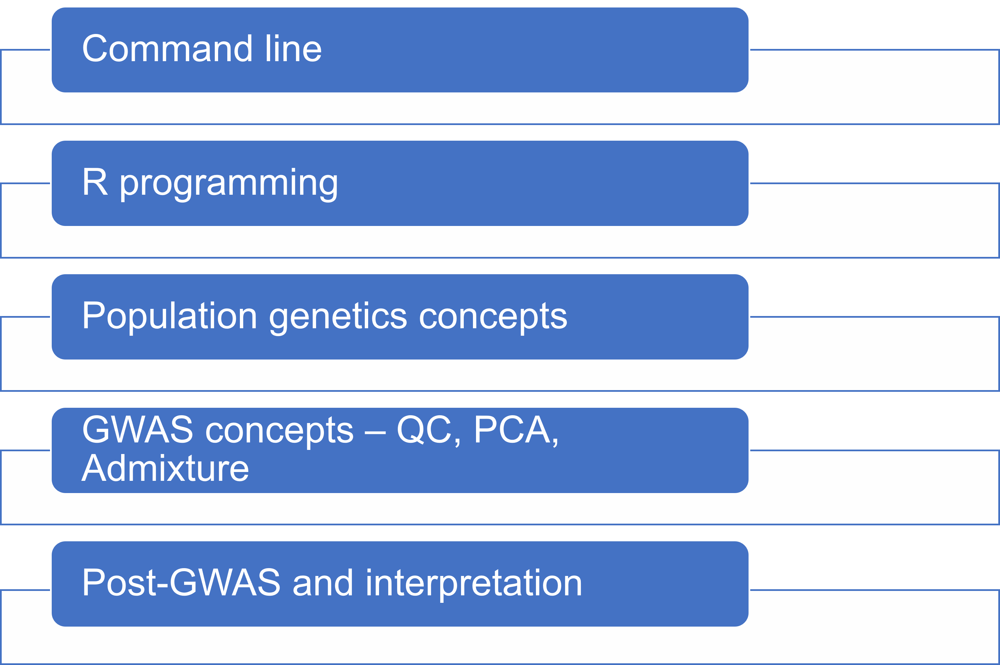

# Session 1: Command Line I

**Olabode Omotoso** 
olabodeomotoso@gmail.com 
October 4, 2026

*Prepared for the Nigerian Liver Cancer Molecular Research Group*

## Why are we here?

- Challenges in liver cancer research
- High burden in Africa
- Genetic susceptibility
- Environmental risk factors
- Need for African genomic data

Guo et al. 2024 https://www.nature.com/articles/s41598-024-77658-2

## What is bioinformatics?

Bioinformatics is the application of computational methods to biological data.

Bioinformatics helps us:

- Process genomic data
- Identify risk and protective variants
- Understand ancestry
- Discover biomarkers, mechanisms or pathways

(https://gwasdiversitymonitor.com/

## Typical genomics workflow

## Why do we need to learn to use Linux?

Most genomics software runs on Linux:

- PLINK
- BCFtools
- Samtools
- ADMIXTURE
- GATK
- SAIGE or REGENIE

## Training run down

**Command Line Foundations I**

- Concepts: terminal vs GUI, filesystem, paths
- Hands-on: `pwd`, `ls`, `cd`, `mkdir`, `cp`, `mv`, `rm`, `man`
- Focus: folder structure, cheat sheet and wildcards

**Command Line Foundations II**

- Concepts: piping, redirection, creating and viewing files (`vi`, `nano`, `touch`)
- Hands-on: `grep`, `cut`, `sort`, `uniq`, `awk`
- Focus: preparing and navigating files

## GUI vs command line

| GUI | Command line |
|---|---|
| Mouse based | Text-based |
| Easier initially | More powerful |
| Limited automation | Highly automated |
| Difficult for large-scale analyses | Ideal for big datasets |

## The terminal, shell and Bash

Are they the same or different?

| Term | What it is |
|---|---|
| Terminal | The window where we type commands |
| Shell | The interpreter that understands and executes the commands |
| Bash | The most widely used Linux shell |

## Summary of today's hands-on session

**Recap**

- Introduction to bioinformatics and liver cancer genomics
- `history`
- `clear`
- `man`
- `ls` (`-lha`)
- Using Tab for auto-completion
- `pwd`
- `cd` (`~`, `../..`, `..`)
- `mkdir`
- `chmod`
- `chmod` (drwx, ugo, 777, 421)

## Additional resources

- Command-line interface: <https://en.wikipedia.org/wiki/Command-line_interface>
