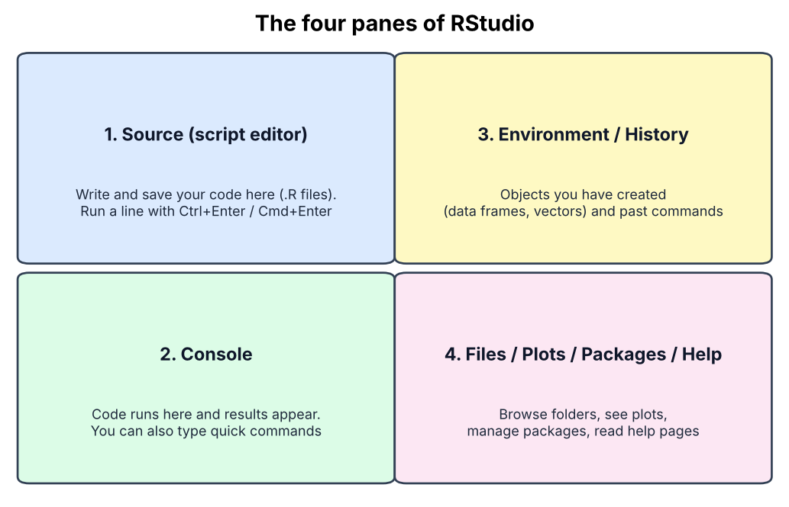
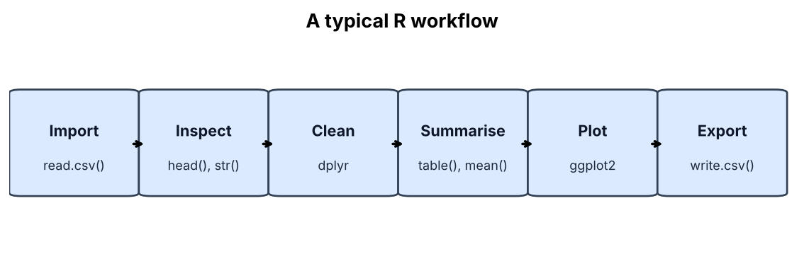
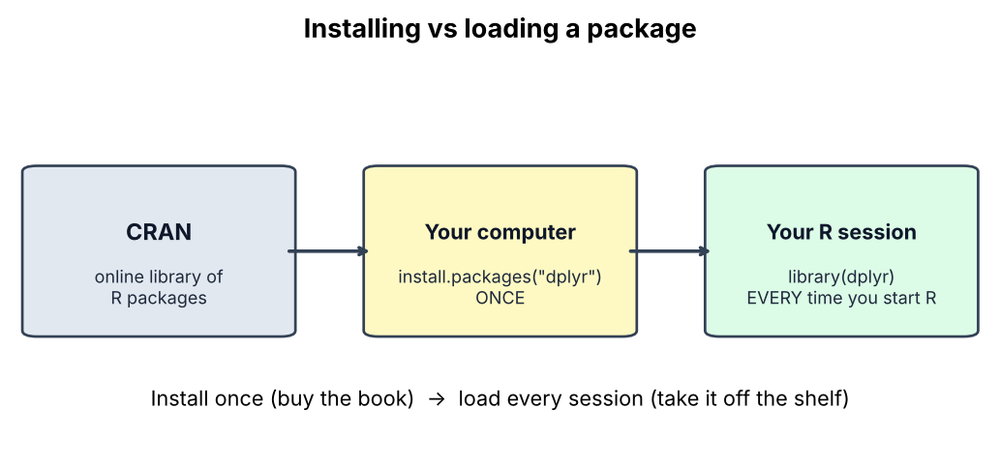

# Session 4: Introduction to R and RStudio

**Olabode Omotoso**<br>
olabodeomotoso@gmail.com<br>
November 15, 2026

*Prepared for the Nigerian Liver Cancer Molecular Research Group*

**Data used today:** `Nigeria_Simulated_Liver_Cancer_Dataset.csv` (1,000 simulated participants, 20 columns)

## Learning objectives

By the end of this session you should be able to:

- Explain what R and RStudio are and install both.
- Find your way around the RStudio panes.
- Set a working directory and understand file paths.
- Recognise common file types and import a CSV file.
- View and inspect a data frame.
- Install and load packages.
- Make a first summary and a first plot.

---

## 1. What is R?

R is a free, open-source programming language built for statistics, data analysis and graphics. It is one of the most widely used tools in genomics.

**Why R for our work?**

- Free, and runs on Windows, Mac and Linux.
- Thousands of packages for genetics and genomics (for example `qqman` for Manhattan plots and `ggplot2` for figures).
- Your analysis is written as code, so it can be saved, repeated and shared. This is what makes research reproducible.
- Strong community and plenty of help online.

**R and RStudio are not the same thing**

| | R | RStudio |
|---|---|---|
| What it is | The language and engine that does the computing | A friendly workspace that sits on top of R |
| Analogy | The car engine | The dashboard and steering wheel |
| Can you use it alone? | Yes, but it is plain | No, it needs R installed first |

Always **install R first, then RStudio**.

---

## 2. Downloading and installing

### Step 1: Install R

1. Go to <https://cran.r-project.org>
2. Choose your system: **Download R for Windows**, **macOS** or **Linux**.
3. Windows: click **base**, then download the installer. Mac: pick the `.pkg` that matches your chip (Apple silicon or Intel).
4. Open the installer and accept the defaults.

### Step 2: Install RStudio

1. Go to <https://posit.co/download/rstudio-desktop/>
2. Download the free **RStudio Desktop** for your system.
3. Install it and accept the defaults.

RStudio is now made by a company called Posit, so you may see that name on the website. It is the same free RStudio.

### Step 3: Check it works

Open **RStudio** (not R). In the **Console** pane type:

```r
1 + 1
```

Press Enter. If you see `[1] 2`, you are ready.

You can also check your R version:

```r
R.version.string
```

**No installation possible on your computer?** Posit Cloud (<https://posit.cloud>) runs RStudio in your browser, and the free plan is enough for practice.

---

## 3. Getting to know RStudio



| Pane | Use it for |
|---|---|
| **Source** (top left) | Writing and saving scripts. Open one with **File > New File > R Script**. |
| **Console** (bottom left) | Where code runs and results appear. |
| **Environment / History** (top right) | See the objects you have made, and the commands you have run. |
| **Files / Plots / Packages / Help** (bottom right) | Browse folders, view plots, manage packages and read help. |

**Useful habits**

- Write code in a **script** (Source), not directly in the Console, so you can save it.
- Run the current line or selection with **Ctrl+Enter** (Windows/Linux) or **Cmd+Enter** (Mac).
- Anything after `#` is a **comment**. R ignores it, so use comments to explain your code.
- Press **Tab** to auto-complete names, just like in the terminal.
- Get help on any function with `?` for example `?mean`.

```r
# This is a comment: R will not run this line
2 + 3      # R will run this part and ignore the comment
```

---

## 4. R as a calculator, and storing things in objects

```r
5 * 4
10 / 3
2 ^ 3
```

Use `<-` (read it as "gets") to store a value in a named **object**:

```r
age <- 61
age
age + 5
```

Naming rules: use letters, numbers, `_` and `.`; do not start with a number; no spaces. R is **case sensitive**, so `Age` and `age` are different objects.

### Basic data types

| Type | Example | Meaning |
|---|---|---|
| numeric | `61`, `19.7` | Numbers |
| character | `"Bayelsa"` | Text, always in quotes |
| logical | `TRUE`, `FALSE` | Yes/no results |
| factor | `Male`, `Female` | A category with fixed levels |

Check any object's type with `class()`:

```r
class(61)
class("Bayelsa")
class(TRUE)
```

### Vectors

A **vector** is a row of values of the same type, made with `c()` (for "combine"):

```r
ages <- c(61, 49, 46, 39)
states <- c("Bayelsa", "Kogi", "Niger", "Kaduna")

mean(ages)
length(states)
states[2]        # second element
ages[ages > 45]  # ages greater than 45
```

---

## 5. Working with files



### Where is R looking? The working directory

R reads and writes files relative to a **working directory**.

```r
getwd()          # show the current working directory
```

Set it in one of two ways:

- **Menu:** Session > Set Working Directory > Choose Directory...
- **Code:**

```r
setwd("C:/Users/yourname/Documents/Liver_Cancer_Group")   # Windows
setwd("~/Documents/Liver_Cancer_Group")                    # Mac / Linux
```

Windows paths use forward slashes `/` in R (or doubled backslashes `\\`). A single `\` will cause an error.

**Tip:** In RStudio you can also make a **Project** (File > New Project). A project sets the working directory for you every time you open it, and is the tidiest way to keep one analysis together.

### Absolute and relative paths

| Type | Example | Meaning |
|---|---|---|
| Absolute | `C:/Users/yourname/Documents/data.csv` | Full address from the top of the computer |
| Relative | `data/data.csv` | Address starting from your working directory |

Relative paths are better because your code still works when the folder moves to another computer.

### Look at what is in your folder

```r
list.files()                 # files in the working directory
list.files("data")           # files inside a folder called data
file.exists("Nigeria_Simulated_Liver_Cancer_Dataset.csv")   # TRUE or FALSE
```

### Getting today's file

Download the file to your working directory. In R:

```r
download.file(
  "https://raw.githubusercontent.com/OlabodeOmotoso/Liver_Cancer_Group/refs/heads/main/Nigeria_Simulated_Liver_Cancer_Dataset.csv",
  destfile = "Nigeria_Simulated_Liver_Cancer_Dataset.csv"
)
```

Or use `wget` / `curl -O` in the terminal as in Session 2. Either way, confirm it with `file.exists()`.

### Understanding different file types

| Extension | What it is | How to read it in R |
|---|---|---|
| `.csv` | Comma-separated table | `read.csv("file.csv")` |
| `.tsv`, `.txt` | Tab-separated or plain text table | `read.delim("file.tsv")` or `read.table("file.txt", header = TRUE)` |
| `.xlsx` | Excel workbook | `readxl::read_excel("file.xlsx")` |
| `.R` | An R script (your code) | Open in RStudio, or `source("file.R")` |
| `.rds` | One R object saved in R's own format | `readRDS("file.rds")` |
| `.RData` | Several R objects saved together | `load("file.RData")` |
| `.vcf`, `.bed`, `.bim`, `.fam` | Genotype data (used in later sessions) | Usually handled by PLINK; results are read into R |

A **CSV** is just text. Open one in Notepad or a text editor to see how it looks: each row is a line, and the commas separate columns. That is why it works everywhere.

---

## 6. Importing and viewing the data

```r
liver <- read.csv("Nigeria_Simulated_Liver_Cancer_Dataset.csv")
```

You now have an object called `liver` in the **Environment** pane. It is a **data frame**: a table where each row is a participant and each column is a variable.

### First look

```r
View(liver)         # opens a spreadsheet-style viewer (capital V)
head(liver)         # first 6 rows
tail(liver)         # last 6 rows
head(liver, 10)     # first 10 rows
```

### Size and structure

```r
dim(liver)          # rows and columns
nrow(liver)         # number of participants
ncol(liver)         # number of variables
names(liver)        # column names
str(liver)          # structure: type of each column
summary(liver)      # quick summary of every column
```

You should see **1,000 rows and 20 columns**.

### The columns in our dataset

| Group | Columns |
|---|---|
| Identification and place | `Participant_ID`, `State`, `Geopolitical_Zone`, `Residence` |
| Demographics | `Age_years`, `Sex`, `Education`, `Occupation` |
| Lifestyle | `Smoking_status`, `Smokeless_tobacco_use`, `Alcohol_use` |
| Risk factors | `HBV_status`, `HCV_status`, `Aflatoxin_exposure`, `BMI_kg_m2`, `Diabetes`, `Family_history_liver_cancer` |
| Outcome and clinical | `Liver_cancer_status`, `Clinical_stage`, `AFP_ng_mL` |

### Working with a single column

Use `$` to pick a column from a data frame:

```r
liver$Age_years
mean(liver$Age_years)
liver$State[1:5]     # first five states
```

### Working with rows and columns by position

The pattern is `data[row, column]`:

```r
liver[1, ]              # row 1, all columns
liver[, 5]              # column 5, all rows
liver[1:5, c(1, 5, 6)]  # rows 1 to 5, columns 1, 5 and 6
```

---

## 7. Summarising categories and numbers

### Categorical variables

```r
table(liver$Liver_cancer_status)
table(liver$Sex)
table(liver$Geopolitical_Zone)
```

For example, the case/control table shows **108 cases and 892 controls**.

Proportions and percentages:

```r
prop.table(table(liver$Liver_cancer_status))
round(prop.table(table(liver$Liver_cancer_status)) * 100, 1)
```

Two variables together (a cross-tab):

```r
table(liver$HBV_status, liver$Liver_cancer_status)
```

### Numeric variables

```r
mean(liver$Age_years)
median(liver$Age_years)
min(liver$Age_years)
max(liver$Age_years)
sd(liver$Age_years)
range(liver$BMI_kg_m2)
```

Compare cases and controls:

```r
tapply(liver$Age_years, liver$Liver_cancer_status, mean)
```

### Missing values

Real data often has gaps, shown as `NA`. This simulated file has none, but you should always check:

```r
sum(is.na(liver))       # total missing values
colSums(is.na(liver))   # missing values per column
```

If a column has `NA`, add `na.rm = TRUE`, for example `mean(x, na.rm = TRUE)`.

---

## 8. Packages (libraries)

A **package** is a bundle of extra functions written by other people. Base R can do a lot, but packages are where most genomics tools live.



### Install once, load every time

```r
install.packages("ggplot2")   # download and install: do this ONCE
library(ggplot2)              # load it: do this EVERY time you start R
```

Notes:

- The name in `install.packages()` is in **quotes**. In `library()` it usually is not.
- You can also use the **Packages** tab in the bottom-right pane: click **Install**, type the name, and click Install.
- If R asks whether to restart or use a personal library, answer **Yes**.

### Packages we will use in this course

| Package | Used for |
|---|---|
| `ggplot2` | Making plots |
| `dplyr` | Filtering, selecting and summarising data |
| `readr` | Fast file reading |
| `readxl` | Reading Excel files |
| `data.table` | Fast handling of very large tables (useful for GWAS output) |
| `qqman` | Manhattan and QQ plots (Session 11) |

Install several at once:

```r
install.packages(c("ggplot2", "dplyr", "readr", "readxl", "data.table", "qqman"))
```

### Finding help

```r
?read.csv                  # help page for a function
help(package = "ggplot2")  # help for a whole package
packageVersion("ggplot2")  # which version is installed
```

Two common errors:

- `could not find function "ggplot"`: you installed the package but forgot `library(ggplot2)`.
- `there is no package called 'ggplot2'`: it is not installed yet, so run `install.packages("ggplot2")`.

---

## 9. A first plot

```r
library(ggplot2)

# Bar chart: participants per zone
ggplot(liver, aes(x = Geopolitical_Zone)) +
  geom_bar() +
  labs(title = "Participants by geopolitical zone",
       x = "Zone", y = "Number of participants")

# Histogram: age distribution
ggplot(liver, aes(x = Age_years)) +
  geom_histogram(binwidth = 5, colour = "white") +
  labs(title = "Age distribution", x = "Age (years)", y = "Count")

# Boxplot: age by case/control status
ggplot(liver, aes(x = Liver_cancer_status, y = Age_years)) +
  geom_boxplot() +
  labs(title = "Age by case-control status", x = "", y = "Age (years)")
```

A ggplot is built in layers: **data** (`liver`), **aesthetics** (`aes()`: what goes on each axis), and a **geom** (the shape: `geom_bar`, `geom_histogram`, `geom_boxplot`). Add layers with `+`. We go deeper in Session 5.

Save the last plot:

```r
ggsave("age_by_status.png", width = 6, height = 4, dpi = 300)
```

---

## 10. Saving your work

```r
# Save a table you made
zone_counts <- as.data.frame(table(liver$Geopolitical_Zone))
write.csv(zone_counts, "zone_counts.csv", row.names = FALSE)

# Save an R object for later
saveRDS(liver, "liver.rds")
liver <- readRDS("liver.rds")
```

Save your **script** too (Ctrl+S or Cmd+S) with a clear name, such as `session4_intro.R`.

**Good habits**

- One folder per project, with sub-folders such as `data/`, `scripts/` and `results/`.
- Start every script with `library()` calls, then import data.
- Comment your code. Future you will be grateful.
- Never edit your raw data file. Do the cleaning in code.

---

## Hands-on practice

Work through these in a new script called `session4_practice.R`.

1. Set your working directory and confirm the data file is there with `file.exists()`.
2. Import the file into an object called `liver`.
3. How many rows and columns does it have?
4. What are the column names, and which are numeric and which are character?
5. How many participants are cases and how many are controls?
6. What is the mean age of cases and of controls?
7. How many participants are HBV positive? (Use `table(liver$HBV_status)`.)
8. Make a bar chart of `Alcohol_use` and save it as a PNG.
9. Install `dplyr`, load it with `library(dplyr)` and run `glimpse(liver)`.

## Cheat sheet

| Task | Code |
|---|---|
| Where am I? | `getwd()` |
| Change folder | `setwd("path")` |
| List files | `list.files()` |
| Read CSV | `read.csv("file.csv")` |
| First rows | `head(df)` |
| Dimensions | `dim(df)` |
| Structure | `str(df)` |
| Summary | `summary(df)` |
| Count categories | `table(df$col)` |
| Pick a column | `df$col` |
| Install package | `install.packages("name")` |
| Load package | `library(name)` |
| Help | `?function_name` |
| Write CSV | `write.csv(df, "out.csv", row.names = FALSE)` |

## Homework

1. Finish any practice questions you did not complete.
2. Make one more plot from the dataset, for example `Aflatoxin_exposure` or `BMI_kg_m2`, and save it.
3. Write three sentences describing what you notice about the cases compared with the controls.

## Additional resources

- R project: <https://www.r-project.org>
- CRAN downloads: <https://cran.r-project.org>
- RStudio Desktop: <https://posit.co/download/rstudio-desktop/>
- Posit Cloud (RStudio in the browser): <https://posit.cloud>
- R for Data Science (free online book): <https://r4ds.hadley.nz>
- ggplot2 documentation: <https://ggplot2.tidyverse.org>
