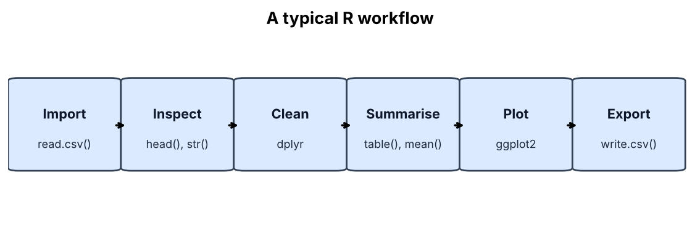
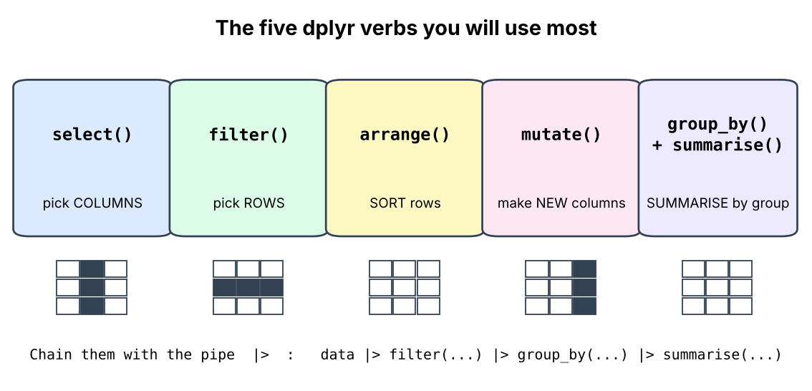
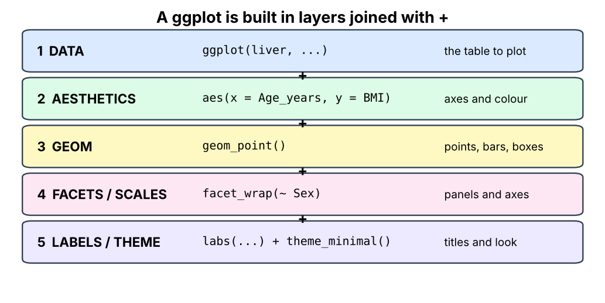
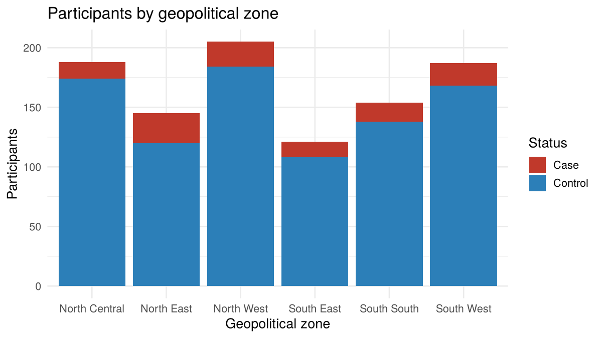
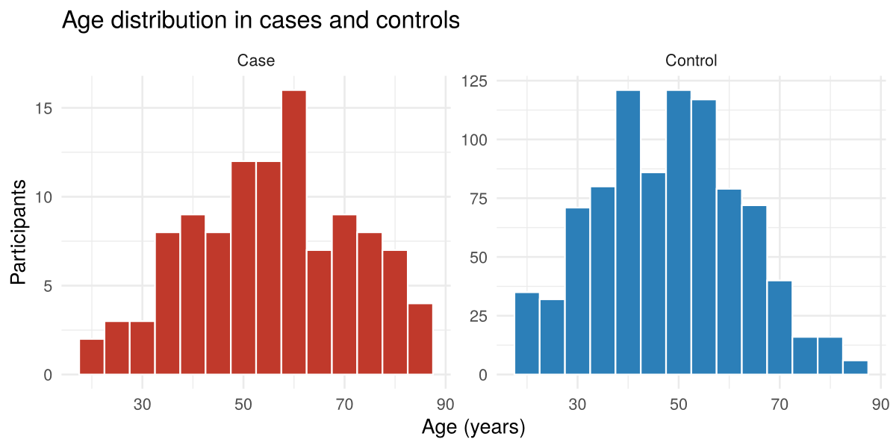
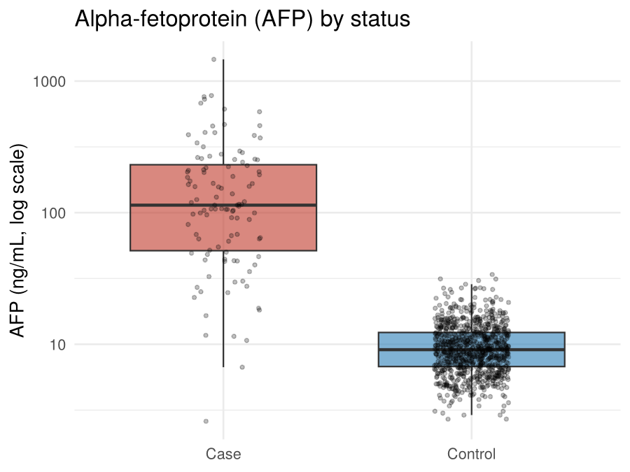
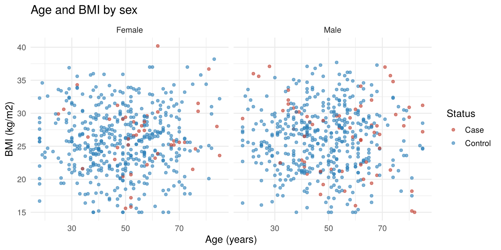
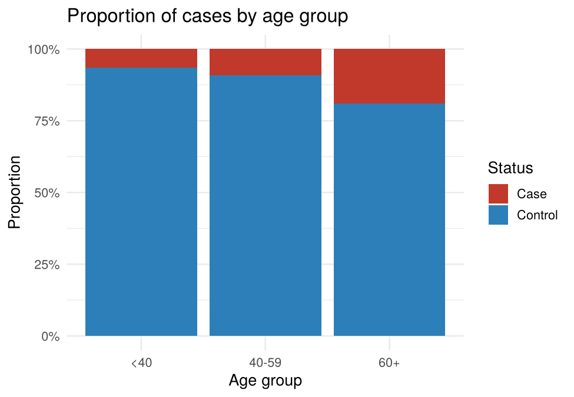
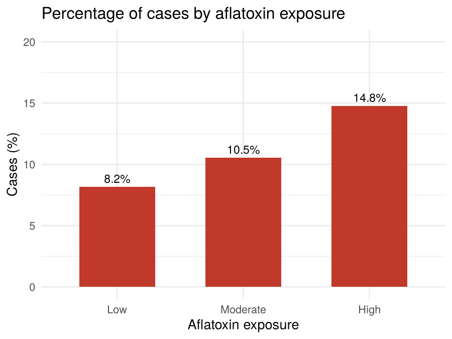

# Session 5: Data Wrangling and Visualization in R

**Olabode Omotoso**<br>
olabodeomotoso@gmail.com<br>
November 29, 2026

*Prepared for the Nigerian Liver Cancer Molecular Research Group*

**Data used today:** `Nigeria_Simulated_Liver_Cancer_Dataset.csv` (1,000 simulated participants, 20 columns)

**Packages:** `dplyr` and `ggplot2`

## Learning objectives

By the end of this session you should be able to:

- Explain what "wrangling" means and why we do it before analysis.
- Use the pipe to chain steps together.
- Select columns, filter rows, sort, create new columns and summarise by group with `dplyr`.
- Combine two tables with a join.
- Build plots in layers with `ggplot2`.
- Choose a suitable plot for the type of data you have.
- Go from a summary table to a finished figure and save it.

**A note on the data.** The dataset is simulated for training. The patterns you see (for example HBV and aflatoxin being linked to more cases) are built into the simulation, so use them to learn the tools and not as research findings.

---

## 1. Setting up

Open RStudio, start a new script called `session5_wrangling.R`, and set your working directory to the folder that holds the data file (see Session 4).

```r
install.packages(c("dplyr", "ggplot2"))   # only if you have not installed them yet

library(dplyr)
library(ggplot2)

liver <- read.csv("Nigeria_Simulated_Liver_Cancer_Dataset.csv")
```

When you load `dplyr` you will see a message that `filter` and `lag` are "masked" from `stats`. This is normal and harmless. It means `dplyr`'s version is now used.

Quick check that the data came in properly:

```r
glimpse(liver)
```

`glimpse()` is a tidy alternative to `str()`. It lists every column, its type and the first values. You should see 1,000 rows and 20 columns.

---

## 2. What is data wrangling?

Raw data is rarely ready for analysis. **Wrangling** means getting the data into the shape you need: keeping the right columns, selecting the right participants, fixing categories, and making new variables.



Today we work on the middle of this workflow: **clean, summarise and plot**.

---

## 3. The pipe

The pipe `|>` takes what is on its left and passes it as the first input to the function on its right. Read it as **"and then"**.

Without a pipe, steps get nested and hard to read:

```r
head(select(liver, Participant_ID, Age_years, Sex), 3)
```

With a pipe, the steps read left to right, like a recipe:

```r
liver |>
  select(Participant_ID, Age_years, Sex) |>
  head(3)
```

Both give the same result:

```
  Participant_ID Age_years    Sex
1       NLCG0001        61   Male
2       NLCG0002        49 Female
3       NLCG0003        46   Male
```

Tips:

- Press **Ctrl+Shift+M** (Windows/Linux) or **Cmd+Shift+M** (Mac) to type a pipe. By default RStudio types the older `%>%`. To get `|>`, go to **Tools > Global Options > Code** and tick **Use native pipe operator**.
- Put a new step on a new line, with the pipe at the end of the line above.
- The `|>` pipe needs R 4.1 or newer. You may see `%>%` in older code. It does the same job.

---

## 4. The main dplyr verbs



### 4.1 `select()`: choose columns

```r
liver |> select(Participant_ID, Age_years, Sex)       # by name
liver |> select(starts_with("Smok"))                  # names that start with "Smok"
liver |> select(-Occupation, -Education)              # drop columns
liver |> select(where(is.numeric))                    # only numeric columns
```

The last line returns `Age_years`, `BMI_kg_m2` and `AFP_ng_mL`. Helpers like `starts_with()`, `ends_with()` and `contains()` save a lot of typing.

### 4.2 `filter()`: choose rows

Keep only the rows where a condition is `TRUE`.

```r
liver |> filter(Liver_cancer_status == "Case")
liver |> filter(Age_years >= 60)
liver |> filter(Liver_cancer_status == "Case", Age_years >= 60)
```

The third line keeps rows that meet **both** conditions: **46 participants** are cases aged 60 or above.

| Operator | Meaning |
|---|---|
| `==` | equal to (two equals signs!) |
| `!=` | not equal to |
| `>`, `>=`, `<`, `<=` | greater or less than |
| `&` | and (a comma also means "and") |
| <code>&#124;</code> | or |
| `!` | not |
| `%in%` | is one of a list |

```r
# Participants from the two northern zones
liver |> filter(Geopolitical_Zone %in% c("North West", "North East"))   # 350 rows

# HBV positive OR HCV positive
liver |> filter(HBV_status == "Yes" | HCV_status == "Yes")             # 173 rows

# Everyone except North West
liver |> filter(!(Geopolitical_Zone == "North West"))                  # 795 rows
```

**Common mistake:** `=` assigns a value and `==` compares. Inside `filter()` you almost always want `==`.

### 4.3 `arrange()`: sort rows

```r
liver |> arrange(Age_years)             # smallest to largest
liver |> arrange(desc(AFP_ng_mL))       # largest to smallest

liver |>
  arrange(desc(AFP_ng_mL)) |>
  select(Participant_ID, Liver_cancer_status, AFP_ng_mL) |>
  head(5)
```

Result:

```
  Participant_ID Liver_cancer_status AFP_ng_mL
1       NLCG0489                Case    1463.2
2       NLCG0009                Case     776.8
3       NLCG0933                Case     761.1
4       NLCG0181                Case     727.9
5       NLCG0425                Case     679.6
```

All five of the highest AFP values belong to cases. `slice_max()` does the same job in one step:

```r
liver |>
  filter(Liver_cancer_status == "Case") |>
  slice_max(AFP_ng_mL, n = 3) |>
  select(Participant_ID, State, AFP_ng_mL)
```

### 4.4 `mutate()`: create or change columns

Make new variables from old ones. Here we make an age group, a BMI category and a log-transformed AFP:

```r
liver <- liver |>
  mutate(
    Age_group = case_when(
      Age_years < 40 ~ "<40",
      Age_years < 60 ~ "40-59",
      TRUE           ~ "60+"
    ),
    BMI_category = case_when(
      BMI_kg_m2 < 18.5 ~ "Underweight",
      BMI_kg_m2 < 25   ~ "Normal",
      BMI_kg_m2 < 30   ~ "Overweight",
      TRUE             ~ "Obese"
    ),
    log_AFP = log10(AFP_ng_mL)
  )
```

`case_when()` goes through the conditions **in order** and uses the first one that is true. `TRUE ~` at the end means "everything else".

For a simple two-way split use `if_else()`:

```r
liver |>
  mutate(High_risk = if_else(HBV_status == "Yes" & Aflatoxin_exposure == "High", "Yes", "No")) |>
  count(High_risk)
```

This flags **35 participants** who are both HBV positive and highly exposed to aflatoxin.

**Categories have an order.** Text columns sort alphabetically, which would put "<40" last in the age groups and "Obese" before "Underweight". Turn them into **factors** with the order you want:

```r
liver <- liver |>
  mutate(
    Age_group    = factor(Age_group, levels = c("<40", "40-59", "60+")),
    BMI_category = factor(BMI_category, levels = c("Underweight", "Normal", "Overweight", "Obese"))
  )
```

Check the new columns:

```r
liver |> count(Age_group)
liver |> count(BMI_category)
```

```
  Age_group   n
1       <40 278
2     40-59 479
3       60+ 243

  BMI_category   n
1  Underweight  71
2       Normal 347
3   Overweight 373
4        Obese 209
```

### 4.5 `count()`, `group_by()` and `summarise()`

`count()` is the fastest way to tabulate:

```r
liver |> count(Liver_cancer_status)
liver |> count(State, sort = TRUE) |> head(5)      # top 5 states by number of participants
```

`group_by()` splits the data into groups, and `summarise()` collapses each group to one row of results:

```r
liver |>
  group_by(Liver_cancer_status) |>
  summarise(
    n          = n(),
    mean_age   = mean(Age_years),
    median_AFP = median(AFP_ng_mL),
    mean_BMI   = mean(BMI_kg_m2)
  )
```

```
  Liver_cancer_status     n mean_age median_AFP mean_BMI
1 Case                  108     55.9      114.      26.7
2 Control               892     48.0        9.1     25.9
```

In this dataset, cases are older on average and have a much higher median AFP.

Group by **two** variables:

```r
liver |>
  group_by(Sex, Liver_cancer_status) |>
  summarise(n = n(), .groups = "drop")
```

**Percent of cases in each group.** A neat trick: `Liver_cancer_status == "Case"` is `TRUE` or `FALSE`, and the mean of `TRUE`/`FALSE` is a proportion.

```r
liver |>
  group_by(Geopolitical_Zone) |>
  summarise(
    n         = n(),
    cases     = sum(Liver_cancer_status == "Case"),
    pct_cases = round(100 * cases / n, 1)
  ) |>
  arrange(desc(pct_cases))
```

```
  Geopolitical_Zone     n cases pct_cases
1 North East          145    25      17.2
2 South East          121    13      10.7
3 South South         154    16      10.4
4 North West          205    21      10.2
5 South West          187    19      10.2
6 North Central       188    14       7.4
```

Do the same for risk factors:

```r
liver |>
  group_by(HBV_status) |>
  summarise(n = n(), pct_cases = round(100 * mean(Liver_cancer_status == "Case"), 1))
```

```
  HBV_status     n pct_cases
1 No           866       8.9
2 Yes          134      23.1
```

Run the same code with `Aflatoxin_exposure` and `Alcohol_use` in place of `HBV_status` and compare the results.

### 4.6 Summarising many columns at once

```r
liver |>
  summarise(across(c(Age_years, BMI_kg_m2, AFP_ng_mL), list(mean = mean, sd = sd)))
```

`across()` applies the same functions to several columns in one go.

### 4.7 `rename()` and `distinct()`

```r
liver |> rename(Age = Age_years)       # new name = old name
liver |> distinct(State)               # unique values (37 in this dataset)
```

---

## 5. Joining two tables

Often your information lives in more than one table, and you need to combine them using a shared column (a **key**). Here we add a North/South label to our data.

```r
zone_info <- data.frame(
  Geopolitical_Zone = c("North West", "North East", "North Central",
                        "South West", "South East", "South South"),
  Region = c("North", "North", "North", "South", "South", "South")
)

liver2 <- left_join(liver, zone_info, by = "Geopolitical_Zone")

liver2 |> count(Region)
```

```
  Region   n
1  North 538
2  South 462
```

`left_join()` keeps every row of the first table and adds matching columns from the second. In genomics we will use the same idea to attach sample information (population, phenotype) to PCA or ADMIXTURE results through the sample ID.

| Join | Keeps |
|---|---|
| `left_join(a, b)` | all rows of `a`, matching rows of `b` |
| `inner_join(a, b)` | only rows found in both |
| `full_join(a, b)` | all rows of both |

---

## 6. Visualization with ggplot2

### 6.1 The grammar of graphics



Every ggplot has three essential parts:

1. **Data**: the table (`liver`).
2. **Aesthetics** `aes()`: which column goes on the x-axis, the y-axis, the colour, and so on.
3. **Geom**: the shape used to draw the data.

Start a plot, then add layers with `+`. The `+` must be at the **end** of the line.

```r
ggplot(liver, aes(x = Age_years, y = BMI_kg_m2)) +
  geom_point()
```

### 6.2 Which plot for which data?

| Question | Variables | Plot |
|---|---|---|
| How many in each category? | one categorical | `geom_bar()` |
| What is the shape of a number? | one numeric | `geom_histogram()` |
| Compare a number between groups | numeric by categorical | `geom_boxplot()` |
| Relationship between two numbers | numeric and numeric | `geom_point()` |
| Percent in each group (already summarised) | summary table | `geom_col()` |

### 6.3 Bar chart: counts by category

Colour the bars by case/control status with `fill`:

```r
cols <- c(Case = "#c0392b", Control = "#2c7fb8")

ggplot(liver, aes(x = Geopolitical_Zone, fill = Liver_cancer_status)) +
  geom_bar() +
  scale_fill_manual(values = cols) +
  labs(title = "Participants by geopolitical zone",
       x = "Geopolitical zone", y = "Participants", fill = "Status") +
  theme_minimal(base_size = 13)
```



### 6.4 Histogram and facets

A histogram shows how a numeric variable is spread out. `facet_wrap()` splits the plot into panels, one per group.

```r
ggplot(liver, aes(x = Age_years, fill = Liver_cancer_status)) +
  geom_histogram(binwidth = 5, colour = "white") +
  facet_wrap(~ Liver_cancer_status, scales = "free_y") +
  scale_fill_manual(values = cols, guide = "none") +
  labs(title = "Age distribution in cases and controls",
       x = "Age (years)", y = "Participants") +
  theme_minimal(base_size = 13)
```



`binwidth = 5` makes each bar five years wide. Try 2 and 10 to see how the picture changes. `scales = "free_y"` lets each panel have its own y-axis, which helps because there are far fewer cases than controls.

### 6.5 Boxplot with a log scale

AFP is very skewed, with a few very high values. A log scale makes the comparison readable.

```r
ggplot(liver, aes(x = Liver_cancer_status, y = AFP_ng_mL, fill = Liver_cancer_status)) +
  geom_boxplot(outlier.shape = NA, alpha = 0.6) +
  geom_jitter(width = 0.15, alpha = 0.25, size = 1) +
  scale_y_log10() +
  scale_fill_manual(values = cols, guide = "none") +
  labs(title = "Alpha-fetoprotein (AFP) by status",
       x = NULL, y = "AFP (ng/mL, log scale)") +
  theme_minimal(base_size = 13)
```



**How to read a boxplot:** the thick line is the median, the box covers the middle 50% of values (the interquartile range), and the whiskers extend to the rest of the typical range. `geom_jitter()` adds the real data points so you can see how many there are.

### 6.6 Scatter plot with colour and facets

```r
ggplot(liver, aes(x = Age_years, y = BMI_kg_m2, colour = Liver_cancer_status)) +
  geom_point(alpha = 0.6) +
  facet_wrap(~ Sex) +
  scale_colour_manual(values = cols) +
  labs(title = "Age and BMI by sex",
       x = "Age (years)", y = "BMI (kg/m2)", colour = "Status") +
  theme_minimal(base_size = 13)
```



`alpha = 0.6` makes points slightly see-through so overlapping points stay visible. Add a trend line with `geom_smooth(method = "lm")`.

### 6.7 Proportions: `position = "fill"`

When groups differ in size, compare **proportions** and not counts:

```r
ggplot(liver, aes(x = Age_group, fill = Liver_cancer_status)) +
  geom_bar(position = "fill") +
  scale_y_continuous(labels = scales::percent) +
  scale_fill_manual(values = cols) +
  labs(title = "Proportion of cases by age group",
       x = "Age group", y = "Proportion", fill = "Status") +
  theme_minimal(base_size = 13)
```



The share of cases rises with age group in this dataset. Compare this with the first bar chart, where the raw counts did not show it as clearly.

### 6.8 From a summary table to a plot

This is the most useful pattern: wrangle with `dplyr`, then plot with `ggplot2`. `geom_col()` plots values that are already in a column.

```r
aflatoxin <- liver |>
  group_by(Aflatoxin_exposure) |>
  summarise(n = n(), pct_cases = 100 * mean(Liver_cancer_status == "Case")) |>
  mutate(Aflatoxin_exposure = factor(Aflatoxin_exposure,
                                     levels = c("Low", "Moderate", "High")))

ggplot(aflatoxin, aes(x = Aflatoxin_exposure, y = pct_cases)) +
  geom_col(fill = "#c0392b", width = 0.6) +
  geom_text(aes(label = paste0(round(pct_cases, 1), "%")), vjust = -0.5) +
  ylim(0, 20) +
  labs(title = "Percentage of cases by aflatoxin exposure",
       x = "Aflatoxin exposure", y = "Cases (%)") +
  theme_minimal(base_size = 13)
```



You can also pipe the summary table straight into ggplot, without saving it first:

```r
liver |>
  count(State) |>
  ggplot(aes(x = reorder(State, n), y = n)) +
  geom_col() +
  coord_flip()
```

`reorder()` sorts the bars by value, and `coord_flip()` turns the chart sideways so long names are readable.

### 6.9 Making plots look good

| Tool | What it does | Example |
|---|---|---|
| `labs()` | titles and axis labels | `labs(title = "...", x = "...", y = "...")` |
| `theme_minimal()`, `theme_bw()`, `theme_classic()` | overall look | `+ theme_bw()` |
| `theme(legend.position = ...)` | move the legend | `+ theme(legend.position = "bottom")` |
| `scale_fill_manual()` | choose your own colours | `values = c(Case = "red", Control = "blue")` |
| `scale_fill_brewer()` | ready-made colour sets | `palette = "Set1"` |
| `facet_wrap(~ var)` | one panel per group | `+ facet_wrap(~ Sex)` |

**Good figure habits**

- Give every axis a clear label, with units.
- Use colours that are easy to tell apart, and keep the same colour for the same group across all figures.
- Plot proportions when group sizes differ.
- Keep the message simple: one plot, one point.

### 6.10 Saving plots

```r
p <- ggplot(liver, aes(x = Age_years)) + geom_histogram(binwidth = 5)

ggsave("age_histogram.png", plot = p, width = 6, height = 4, dpi = 300, bg = "white")
ggsave("age_histogram.pdf", plot = p, width = 6, height = 4)
```

Use **PNG** for slides and documents and **PDF** (a vector format) for journal figures. `bg = "white"` avoids a transparent background that can look black in some viewers.

---

## 7. Saving your wrangled data

```r
cases_only <- liver |> filter(Liver_cancer_status == "Case")
write.csv(cases_only, "cases_only.csv", row.names = FALSE)    # 108 rows
```

Always keep the original file untouched and write new results to new files.

---

## Hands-on practice

Work in a new script called `session5_practice.R`.

**Wrangling**

1. Make a table with only `Participant_ID`, `Sex`, `Age_years` and `HBV_status`.
2. How many female participants are HBV positive?
3. Find the 10 oldest participants and show their `Age_years` and `Liver_cancer_status`.
4. Create a new column called `Older` that is "Yes" for age 50 or above and "No" otherwise.
5. What is the mean BMI in each `Aflatoxin_exposure` group?
6. What percentage of cases are in each `Alcohol_use` group? (Hint: group by `Alcohol_use` and use `mean(Liver_cancer_status == "Case")`.)
7. Which three states have the most participants?
8. Join the `zone_info` table to the data and compare the percentage of cases in the North and the South.

**Plotting**

9. Make a bar chart of `Alcohol_use` filled by `Liver_cancer_status`.
10. Make a boxplot of `BMI_kg_m2` by `Liver_cancer_status`.
11. Make a proportion bar chart of `HBV_status` filled by `Liver_cancer_status`. What do you notice?
12. Choose your own question about the data, answer it with one `dplyr` summary and one plot, and save the plot as a PNG.

## Cheat sheet

| Task | Code |
|---|---|
| Pipe | <code>&#124;&gt;</code> |
| Choose columns | `select(a, b)` |
| Choose rows | `filter(col == "value")` |
| Sort | `arrange(col)` or `arrange(desc(col))` |
| New column | `mutate(new = ...)` |
| Categories from numbers | `case_when(...)` |
| Count | `count(col)` |
| Summary by group | <code>group_by(col) &#124;&gt; summarise(mean = mean(x))</code> |
| Join tables | `left_join(a, b, by = "key")` |
| Start a plot | `ggplot(data, aes(x = , y = ))` |
| Bars (counts) | `geom_bar()` |
| Bars (values) | `geom_col()` |
| Histogram | `geom_histogram(binwidth = 5)` |
| Boxplot | `geom_boxplot()` |
| Points | `geom_point()` |
| Panels | `facet_wrap(~ col)` |
| Labels | `labs(title = , x = , y = )` |
| Save | `ggsave("file.png", width = 6, height = 4, dpi = 300)` |

## Homework

1. Finish any practice questions you did not complete.
2. Make one figure suitable for a slide that shows the relationship between **one risk factor** and case/control status. Include a title, axis labels and a clear colour choice.
3. Write three sentences describing what the figure shows.
4. Save your script and bring it to the next session.

## Additional resources

- R for Data Science, the chapters on data transformation and visualization: <https://r4ds.hadley.nz>
- dplyr documentation: <https://dplyr.tidyverse.org>
- ggplot2 documentation: <https://ggplot2.tidyverse.org>
- ggplot2 cheat sheet: <https://posit.co/resources/cheatsheets/>
- From Data to Viz (helps you choose a plot): <https://www.data-to-viz.com>
